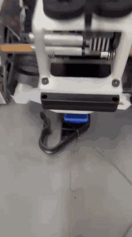
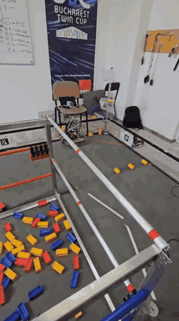

# SummerRobot2025 – Vision-guided autonomous collection (FTC INTO THE DEEP)

Off-season robot code for **StarLight #24909**, a FIRST Tech Challenge (FTC) team from Pitești, Romania.
FTC is an international high-school robotics competition: every season, teams design, build and program a
robot for a new game. This repo is our summer 2025 robot for the INTO THE DEEP game, in which robots
pick up rectangular game pieces ("samples") from the floor and score them.

The main feature is **camera-guided collection**: in the 30-second autonomous phase, the robot finds a
game piece on the floor, works out where it is, and reaches out to grab it with no driver input.

| Grabbing a detected piece | Autonomous collection on the field (2.5× speed) |
|---|---|
|  |  |

## Results

- Autonomous score went from **38 to 56 points (+47%)** after adding vision-guided collection.
- The robot detected and collected the target piece **about 80% of the time**.
- If a grab fails, the routine repositions and tries again; after 3 failed tries on our alliance's color it
  switches to the neutral yellow pieces instead of wasting the rest of the period.

## How the vision works

1. **Detection.** A Limelight 3A camera runs a neural-network detector that labels each game piece by
   color (red, blue, yellow) and reports the angles to it.
2. **From angles to a floor position** (`Modules/misc/Limelight.java`). Because the camera sits at a known
   height *h* and tilt *θ*, each detection can be turned into a distance on the floor:

   ```
   forward  = h / tan(θ − ty)
   sideways = √(forward² + h²) · tan(tx)
   ```

   That vector is then rotated by the robot's heading so it is in field coordinates.
3. **Choosing a piece that can be grabbed.** The code measures each detection's bounding box and only keeps
   pieces lying at a usable angle and inside a window in front of the intake.
4. **Reaching it.** The autonomous routine converts the piece's position into an **intake extension length
   and a turret angle**, moves both mechanisms, and closes the claw.

## Software architecture

The robot code is organized top-down: one robot class owns every mechanism, and each mechanism is a
small, independent **state machine** that can be tested and changed on its own.

```
SaibaModules (the whole robot)
├── Intake:  EXT (extension) · INBRAT (arm) · INROTATOR (wrist) · INTUR (turret) · INCLAW (claw) · WEELIE
├── Outtake: LIFT · LINKEAGE · OUTBRAT (arm) · OUTROTATIE (wrist) · OUTCLAW (claw) · PTO
└── Drive:   SaibaControl
```

- Every module exposes a `State` enum (for example the turret: `FRONT`, `TRANSFER`, `AUTOSPECI`) and an
  `update()` method, so autonomous and driver-control code only ever say *"go to this state"*.
- Robot position comes from **goBILDA Pinpoint** odometry; paths are followed with **Pedro Pathing** and
  a PID point-to-point follower (`robotoffseason/CurbeBezier/Follower.java`).
- Live tuning of PID constants and camera parameters through **FTC Dashboard**.

## Where to look

| Path (under `TeamCode/src/main/java/org/firstinspires/ftc/teamcode/`) | What's there |
|---|---|
| `robotoffseason/Modules/` | The mechanism modules and the `SaibaModules` robot class |
| `robotoffseason/Modules/misc/Limelight.java` | Detection → floor position → field position |
| `robotoffseason/CurbeBezier/SPECIRED.java`, `SPECIBLUE.java` | Vision-guided autonomous routines (red / blue side) |
| `robotoffseason/Modules/AUTOS/` | Other autonomous routines and tests |
| `robotoffseason/teleoppedro.java` | Driver-control program (built on a Pedro Pathing example) |

## My part

I led the programming for this robot: I designed the module architecture, wrote the detection-to-position
code and the vision-guided autonomous routines, and tuned them on the field with my teammates.

## Built with

Java · FTC SDK 10.1 (INTO THE DEEP) · Limelight 3A · goBILDA Pinpoint · Pedro Pathing · FTCLib ·
Road Runner (core) · FTC Dashboard

<!-- If the helpers in roboDrive/ or util/ came from another team's open-source code, credit them here. -->
